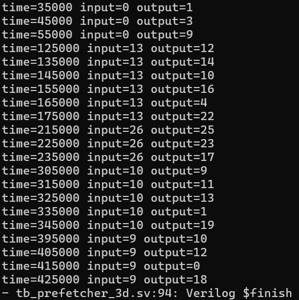
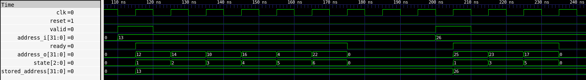
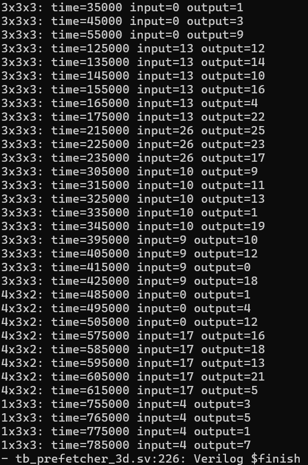
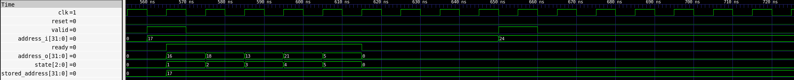
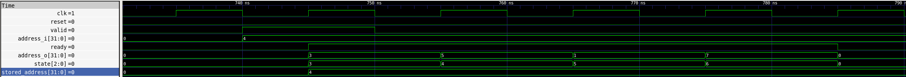

# 3D Spatial Prefetcher

## Overview

This project implements a parameterized 3D spatial prefetcher in SystemVerilog.

The prefetcher takes an address corresponding to a point in a 3D structure and outputs the addresses of all valid adjacent points, one per clock cycle.

The project began with a fixed `3 x 3 x 3` implementation and was then generalized to support arbitrary:

```text
X_SIZE x Y_SIZE x Z_SIZE
```

dimensions.

After completing the parameterized design, two additional implementations were developed to investigate the hardware cost of division and modulo operations used for coordinate recovery.

The project therefore contains three functionally equivalent parameterized implementations:

- **Baseline** — reconstructs x, y, and z coordinates using division and modulo.
- **Reduced-arithmetic** — removes all division and uses only two modulo operations.
- **Comparison-only** — removes both division and modulo and instead generates boundary-comparison logic.

The implementations were verified using Verilator and synthesized with Yosys to compare their resulting logic complexity.

---

## Implementations

| Version | RTL | Description |
| --- | --- | --- |
| Original fixed `3 x 3 x 3` | [`rtl/prefetcher_3d_3x3x3.sv`](rtl/prefetcher_3d_3x3x3.sv) | Original non-parameterized implementation |
| Baseline parameterized | [`rtl/prefetcher_3d.sv`](rtl/prefetcher_3d.sv) | Reconstructs x, y, and z using `/` and `%` |
| Reduced-arithmetic | [`rtl/prefetcher_3d_reduced.sv`](rtl/prefetcher_3d_reduced.sv) | Removes division and uses two modulo operations |
| Comparison-only | [`rtl/prefetcher_3d_compare.sv`](rtl/prefetcher_3d_compare.sv) | Removes both division and modulo |

Detailed implementation and synthesis analysis is available in:

- [`docs/notes_3x3x3.md`](docs/notes_3x3x3.md)
- [`docs/notes_parameterized.md`](docs/notes_parameterized.md)
- [`docs/notes_optimization.md`](docs/notes_optimization.md)

---

## Interface

All parameterized implementations use the same interface.

| Signal | Direction | Description |
| --- | --- | --- |
| `clk` | Input | Clock |
| `reset` | Input | Resets state |
| `address_i` | Input | Input address |
| `valid` | Input | Indicates `address_i` is valid |
| `address_o` | Output | Prefetched output address |
| `ready` | Output | Indicates `address_o` is valid |

The prefetcher accepts a new input only while in `IDLE`.

If `valid` is asserted while a previous request is still being processed, the new input is not accepted.

`ready` is used as an output-valid signal. When:

```text
ready = 1
```

`address_o` contains a valid neighboring address.

---

## Address Mapping

The 3D structure is flattened into a linear address space.

The x coordinate changes fastest, followed by y, then z.

For a parameterized:

```text
X_SIZE x Y_SIZE x Z_SIZE
```

structure, the valid address range is:

```text
0 to X_SIZE * Y_SIZE * Z_SIZE - 1
```

The neighboring-address offsets are:

```text
x: +/- 1
y: +/- X_SIZE
z: +/- (X_SIZE * Y_SIZE)
```

For example, a `3 x 3 x 3` structure is laid out as:

### z = 0

```text
0  1  2
3  4  5
6  7  8
```

### z = 1

```text
9  10 11
12 13 14
15 16 17
```

### z = 2

```text
18 19 20
21 22 23
24 25 26
```

For address `13`, the valid adjacent addresses are:

```text
12, 14, 10, 16, 4, 22
```

---

## FSM Design

The prefetcher uses the following FSM:

```text
IDLE
  -> X_MINUS
  -> X_PLUS
  -> Y_MINUS
  -> Y_PLUS
  -> Z_MINUS
  -> Z_PLUS
  -> IDLE
```

Each directional state corresponds to one possible neighboring address.

Invalid directions are skipped when selecting the next state, allowing valid output addresses to be generated on consecutive cycles without unnecessary dead cycles.

While a valid neighbor is being output:

```text
ready = 1
```

While in `IDLE`:

```text
ready = 0
```

---

## Storing the Input Address

One request can require several cycles because a point may have up to six valid neighbors.

The accepted request is copied into:

```text
stored_address
```

so `address_i` does not need to remain unchanged while the request is being processed.

After leaving `IDLE`, neighbor generation uses `stored_address`.

A timing issue appears on the initial state transition because the newly accepted value does not reach `stored_address` until the active clock edge.

The design therefore uses the live `address_i` value while in `IDLE` and switches to `stored_address` after the request has been accepted.

---

## Baseline Parameterized Design

The baseline implementation is:

[`rtl/prefetcher_3d.sv`](rtl/prefetcher_3d.sv)

It reconstructs the three coordinates using:

```text
x = addr % X_SIZE
y = (addr / X_SIZE) % Y_SIZE
z = addr / (X_SIZE * Y_SIZE)
```

The coordinates determine whether each neighboring direction is valid:

```text
X_MINUS valid if X_SIZE > 1 and x > 0
X_PLUS  valid if X_SIZE > 1 and x < X_SIZE - 1

Y_MINUS valid if Y_SIZE > 1 and y > 0
Y_PLUS  valid if Y_SIZE > 1 and y < Y_SIZE - 1

Z_MINUS valid if Z_SIZE > 1 and z > 0
Z_PLUS  valid if Z_SIZE > 1 and z < Z_SIZE - 1
```

### Coordinate Widths

Coordinate widths are calculated using `$clog2`.

A minimum width of one bit is used so dimensions of size 1 remain legal:

```text
X_BITS = (X_SIZE <= 1) ? 1 : ceil(log2(X_SIZE))
Y_BITS = (Y_SIZE <= 1) ? 1 : ceil(log2(Y_SIZE))
Z_BITS = (Z_SIZE <= 1) ? 1 : ceil(log2(Z_SIZE))
```

If a dimension has size 1, both directions on that axis are disabled.

### Invalid Addresses

A request is accepted only when:

```text
address_i < X_SIZE * Y_SIZE * Z_SIZE
```

Out-of-range requests are ignored and the FSM remains in `IDLE`.

---

## Verification

The parameterized design was tested using several structures.

### 3 x 3 x 3

| Input | Position | Expected Outputs |
| ---: | --- | --- |
| `0` | Corner | `1, 3, 9` |
| `13` | Center | `12, 14, 10, 16, 4, 22` |
| `26` | Corner | `25, 23, 17` |
| `10` | Face | `9, 11, 13, 1, 19` |
| `9` | Edge | `10, 12, 0, 18` |

Terminal results:



Waveform:



### 4 x 3 x 2

For this configuration:

```text
x offset = 1
y offset = 4
z offset = 12
```

For address `17`, the expected outputs are:

```text
16, 18, 13, 21, 5
```

The design was also tested with invalid address `24`, which correctly produced no outputs.

Terminal results:



Waveform:



### 1 x 3 x 3

This configuration verifies support for dimensions of size 1.

For address `4`, the expected outputs are:

```text
3, 5, 1, 7
```

with no x-direction neighbors.

Waveform:



The reduced-arithmetic and comparison-only implementations were also simulated against the same expected behavior.

---

## Arithmetic Optimization

The baseline coordinate reconstruction is straightforward, but `/` and `%` by arbitrary constants can synthesize into substantial combinational logic.

Two alternative implementations were therefore developed.

### Reduced-Arithmetic

[`rtl/prefetcher_3d_reduced.sv`](rtl/prefetcher_3d_reduced.sv)

The reduced-arithmetic implementation removes all division.

It calculates:

```text
row_position   = addr % X_SIZE
plane_position = addr % PLANE_SIZE
```

where:

```text
PLANE_SIZE = X_SIZE * Y_SIZE
```

X and Y boundaries are determined using those two positions.

Z boundaries can be determined directly from comparisons against `PLANE_SIZE`.

The implementation therefore contains:

```text
0 division operations
2 modulo operations
```

### Comparison-Only

[`rtl/prefetcher_3d_compare.sv`](rtl/prefetcher_3d_compare.sv)

The comparison-only implementation removes both division and modulo.

Instead, parameterized loops generate fixed checks for row and plane boundaries.

For each row:

```text
row start = row * X_SIZE
row end   = row * X_SIZE + X_SIZE - 1
```

Because the loop bounds are parameters known during elaboration, synthesis expands them into fixed comparison logic.

This approach is very efficient for small grids, but the number of generated comparisons increases with the configured dimensions.

---

## Synthesis Method

The three implementations were synthesized using Yosys 0.33.

The general synthesis flow was:

```text
read_verilog -sv <rtl>;
chparam -set X_SIZE <X> -set Y_SIZE <Y> -set Z_SIZE <Z> <top>;
hierarchy -top <top>;
synth -top <top>;
stat;
```

The final generic Yosys cell count is used as a structural-area proxy.

These counts are **not physical silicon area measurements**.

Physical area and timing results would require mapping to a target standard-cell library and using an appropriate backend flow.

---

## Representative Synthesis Results

| Configuration | Baseline | Reduced | Compare-only |
| --- | ---: | ---: | ---: |
| 3 x 3 x 3 | 15097 | 10638 | **735** |
| 4 x 3 x 2 | 10303 | 5763 | **915** |
| 7 x 5 x 4 | 14237 | 10085 | **873** |
| 8 x 8 x 8 | **1029** | 1106 | 1701 |
| 17 x 13 x 9 | 13086 | 9570 | **1819** |

For small non-power-of-two configurations, the comparison-only implementation can be dramatically smaller than either arithmetic implementation.

The `8 x 8 x 8` case is different because the relevant divisors are powers of two.

At this point the ordering becomes:

```text
baseline < reduced < comparison-only
```

because division and modulo by powers of two can reduce to shifts, masks, or direct bit selection.

---

## Synthesis Scaling

A larger cube sweep was performed with:

```text
X_SIZE = Y_SIZE = Z_SIZE = N
```

to study how the three implementations scale.


The horizontal axis shows the number of elements:

```text
N^3
```

and uses a **logarithmic scale** because the tested structures span a large range of cube sizes.

The comparison-only implementation grows steadily as the dimensions increase.

For an `N x N x N` cube, the number of rows relevant to the X-boundary logic grows approximately as:

```text
N^2
```

so synthesis generates an increasing amount of comparison logic.

The arithmetic implementations behave differently.

The address datapath remains fixed at 32 bits, and division/modulo networks are synthesized specifically for the exact constant divisors.

As a result, baseline and reduced-arithmetic cell counts:

- oscillate between nearby values of `N`
- do not scale monotonically
- show an overall downward trend across much of the larger sweep

This behavior is caused by constant-specific arithmetic synthesis and Boolean optimization rather than by larger dimensions inherently requiring less hardware.

The comparison-only design, by contrast, has a much smoother upward trend because its dominant cost comes directly from the increasing number of generated boundary comparisons.

---

## Power-of-Two Dimensions

Power-of-two dimensions form an important special case.

Two measured examples are:

| Cube Size | Baseline | Reduced | Compare-only |
| --- | ---: | ---: | ---: |
| 8 x 8 x 8 | **1029** | 1106 | 1701 |
| 32 x 32 x 32 | **994** | 1059 | 7975 |

At both points:

```text
baseline < reduced < comparison-only
```

At `32^3`, the arithmetic implementations show an especially large dip.

This occurs because:

```text
X_SIZE = 32
PLANE_SIZE = 32 * 32 = 1024
```

are both powers of two.

Division and modulo by these values reduce to inexpensive binary operations instead of general constant-divisor arithmetic.

---

## Fine Crossover Study

A continuous sweep from:

```text
30 x 30 x 30
```

through:

```text
43 x 43 x 43
```

was performed to examine the crossover region.


Representative results are:

| N | Baseline | Reduced | Compare-only |
| ---: | ---: | ---: | ---: |
| 30 | 12946 | 9615 | **7723** |
| 31 | 12310 | 8995 | **7954** |
| 32 | **994** | 1059 | 7975 |
| 33 | 12044 | 8947 | **8835** |
| 34 | 12594 | 9493 | **9395** |
| 35 | 12010 | **8911** | 9753 |
| 36 | 12521 | **9425** | 10041 |
| 37 | 12052 | **8951** | 10693 |
| 38 | 12547 | **9456** | 11310 |
| 39 | 11891 | **8807** | 11812 |
| 40 | 12489 | **9420** | 11848 |
| 41 | 12081 | **8966** | 12802 |
| 42 | 12569 | **9468** | 13338 |
| 43 | 11960 | **8825** | 13891 |

The `32^3` power-of-two case creates a local reversal, so it is more useful to distinguish isolated power-of-two behavior from the **persistent crossovers**.

### Reduced vs. Comparison-Only

The measured ordering around the power-of-two case is:

```text
30-31:
comparison-only < reduced

32:
reduced < comparison-only

33-34:
comparison-only < reduced

35+:
reduced < comparison-only
```

The persistent crossover therefore occurs at:

```text
35 x 35 x 35
```

From `35^3` through the remainder of the measured sweep, reduced-arithmetic remains smaller than comparison-only.

### Baseline vs. Comparison-Only

Similarly:

```text
30-31:
comparison-only < baseline

32:
baseline < comparison-only

33-40:
comparison-only < baseline

41+:
baseline < comparison-only
```

The persistent crossover occurs at:

```text
41 x 41 x 41
```

---

## Arithmetic Oscillation

The fine sweep also reveals a regular oscillation in both arithmetic implementations.

Outside the `32^3` special case, the reduced implementation alternates roughly between:

```text
odd N:  about 8.8k - 9.0k cells
even N: about 9.4k - 9.5k cells
```

The baseline shows a similar alternating pattern.

This happens because changing `N` changes the exact compile-time constants used by the `/` and `%` operations.

Yosys therefore synthesizes a different constant-specialized Boolean network for each configuration.

Properties such as the binary representation and factorization of the divisors affect the generated logic, and Yosys/ABC may optimize neighboring constants differently.

The oscillation is therefore a synthesis effect rather than measurement noise.

Repeated synthesis of the same configurations produced the same generic cell counts.

---

## Key Synthesis Findings

The main results are:

- comparison-only is extremely efficient for small non-power-of-two grids
- generated comparison logic grows steadily as grid dimensions increase
- reduced-arithmetic scales much better for larger arbitrary dimensions
- baseline and reduced arithmetic do not scale monotonically because constant division/modulo cost depends on the exact divisor
- baseline and reduced show an overall downward trend over much of the larger sweep
- both arithmetic implementations show noticeable even/odd oscillation in the fine sweep
- power-of-two dimensions create major arithmetic-area dips
- at both measured power-of-two cases:

```text
baseline < reduced < comparison-only
```

- the persistent reduced-vs-comparison crossover occurs at `35^3`
- the persistent baseline-vs-comparison crossover occurs at `41^3`

More detailed analysis is available in:

[`docs/notes_optimization.md`](docs/notes_optimization.md)

---

## Challenges and Design Decisions

### Understanding the Address Mapping

The interface provides only a flattened address rather than explicit x, y, and z coordinates.

The structure is therefore treated as a flattened 3D array.

This allows neighboring addresses to be determined using row and plane sizes.

### Preventing Boundary Wraparound

Simply adding or subtracting neighbor offsets is not sufficient.

For example, subtracting 1 normally represents `X_MINUS`.

If the current point already has:

```text
x = 0
```

then subtracting 1 would cross into the previous row rather than produce a valid x neighbor.

Each implementation therefore checks direction validity before entering the corresponding FSM state.

### Producing Multiple Outputs from One Input

A point may have between three and six valid adjacent neighbors while the interface has only one output address.

The directional FSM emits the neighbors sequentially, one per cycle.

Invalid directions are skipped.

### Input Address Changing During Processing

A request requires several cycles.

The accepted address is therefore stored in `stored_address` so the source does not need to hold `address_i` constant throughout processing.

### First-State Timing

The newly accepted address does not appear in `stored_address` until the active clock edge.

The first next-state decision therefore uses the live `address_i`.

After leaving `IDLE`, calculations use the stored address.

### Division and Modulo Cost

The original parameterized implementation reconstructs coordinates using `/` and `%`.

Synthesis showed that arbitrary non-power-of-two constant divisors can produce substantial logic.

The reduced-arithmetic and comparison-only implementations were developed to explore alternatives to this cost.

---

## Repository Structure

```text
.
├── rtl/
│   ├── prefetcher_3d_3x3x3.sv
│   ├── prefetcher_3d.sv
│   ├── prefetcher_3d_reduced.sv
│   └── prefetcher_3d_compare.sv
│
├── sim/
│   ├── tb_prefetcher_3d_3x3x3.sv
│   ├── tb_prefetcher_3d.sv
│   ├── tb_prefetcher_3d_reduced.sv
│   ├── tb_prefetcher_3d_compare.sv
│   └── Makefile
│
├── synth/
│   ├── run_synth.sh
│   ├── run_synth_large.sh
│   ├── run_synth_crossover.sh
│   ├── results/
│   ├── results_large/
│   └── results_crossover/
│
└── docs/
    ├── notes_parameterized.md
    ├── notes_optimization.md
    └── screenshots/
        ├── synthesis_scaling.png
        ├── synthesis_crossover.png
        └── ...

```

---

## Simulation

Simulation is performed using Verilator.

The three parameterized implementations have separate testbenches:

```text
sim/tb_prefetcher_3d.sv
sim/tb_prefetcher_3d_reduced.sv
sim/tb_prefetcher_3d_compare.sv
```

From the `sim` directory, use the Makefile to build and run the desired simulation.

Generated VCD waveforms can be opened using GTKWave.

For example:

```bash
gtkwave waveform.vcd
```

---

## Synthesis Scripts

Synthesis experiments are located in:

```text
synth/
```

### `run_synth.sh`

Runs representative configurations for all three implementations.

### `run_synth_large.sh`

Runs larger cube configurations to study scaling.

### `run_synth_crossover.sh`

Runs a continuous fine sweep around the crossover region.

The current crossover study uses:

```text
30 x 30 x 30
through
43 x 43 x 43
```

---

## Final Result

The project contains three functionally equivalent parameterized implementations of a 3D spatial prefetcher.

All versions:

- support arbitrary positive `X_SIZE x Y_SIZE x Z_SIZE` dimensions
- use flattened 3D address mapping
- output one valid adjacent address per clock cycle
- skip invalid directions without unnecessary output gaps
- store the active request internally
- support dimensions of size 1
- reject out-of-range addresses
- preserve the same external interface and output behavior

The implementations differ in how boundary validity is calculated:

- **Baseline:** reconstructs coordinates using division and modulo.
- **Reduced-arithmetic:** removes division and uses two modulo operations.
- **Comparison-only:** removes division and modulo entirely.

Synthesis demonstrates that no single implementation is smallest for every possible parameter configuration.

For small arbitrary grids, comparison-only can be dramatically smaller.

For larger arbitrary dimensions, reduced-arithmetic provides the best general-purpose scaling among the tested implementations.

Power-of-two dimensions are a special case in which baseline arithmetic becomes extremely inexpensive.

The project therefore demonstrates both the functional design of a parameterized spatial prefetcher and the hardware tradeoffs introduced by different methods of determining 3D boundaries from a flattened address.
