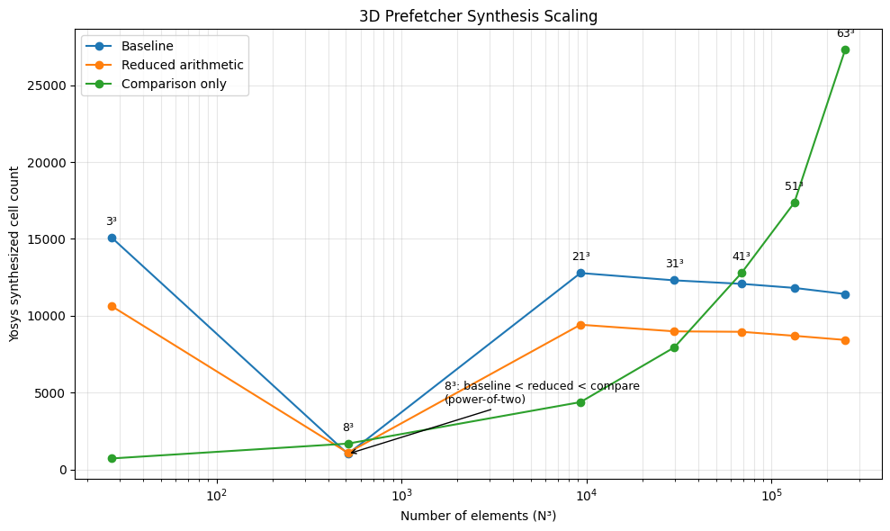
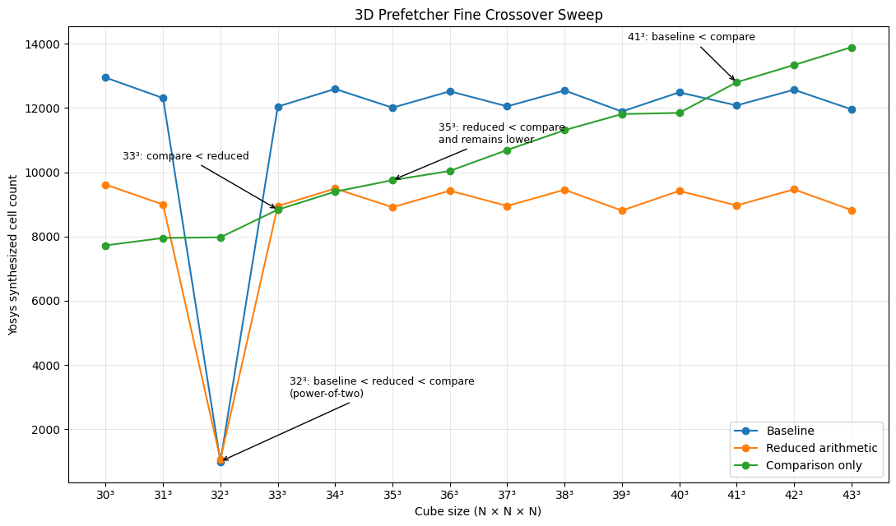

# 3D Prefetcher Arithmetic Optimization

This document compares the baseline parameterized 3D prefetcher against two alternative implementations designed to reduce the hardware cost of dynamic division and modulo operations.

The three implementations preserve the same external behavior and differ only in how they determine whether each neighboring direction is valid.

## Implementations

### Baseline

The baseline implementation reconstructs the 3D coordinates from the flattened address using:

- `x = addr % X_SIZE`
- `y = (addr / X_SIZE) % Y_SIZE`
- `z = addr / (X_SIZE * Y_SIZE)`

This approach is straightforward and closely matches the mathematical mapping from a flattened address back to 3D coordinates.

However, division and modulo by arbitrary constants can synthesize into substantial combinational logic.

### Reduced-Arithmetic Version

The reduced-arithmetic implementation removes all division operations.

It calculates:

- `row_position = addr % X_SIZE`
- `plane_position = addr % PLANE_SIZE`

where:

- `PLANE_SIZE = X_SIZE * Y_SIZE`
- `TOTAL_SIZE = X_SIZE * Y_SIZE * Z_SIZE`

The boundary checks are then derived directly from the row and plane positions:

```text
x_minus_valid:
    X_SIZE > 1
    and row_position > 0

x_plus_valid:
    X_SIZE > 1
    and row_position < X_SIZE - 1

y_minus_valid:
    Y_SIZE > 1
    and plane_position >= X_SIZE

y_plus_valid:
    Y_SIZE > 1
    and plane_position < PLANE_SIZE - X_SIZE

z_minus_valid:
    Z_SIZE > 1
    and addr >= PLANE_SIZE

z_plus_valid:
    Z_SIZE > 1
    and addr < TOTAL_SIZE - PLANE_SIZE
```

This reduces the coordinate-recovery logic from several division/modulo operations to two modulo operations plus comparisons.

### Comparison-Only Version

The comparison-only implementation removes both division and modulo.

Instead, boundary locations are generated using parameterized loops.

For each row, the X boundaries are:

```text
row_start = row * X_SIZE
row_end   = row * X_SIZE + X_SIZE - 1
```

The implementation checks whether the active address is equal to one of these row boundaries.

For Y boundaries, the first and last row of each plane are checked.

Z boundaries are determined directly using comparisons against `PLANE_SIZE`.

Because the loop bounds depend only on parameters, synthesis expands the loops into fixed comparison logic.

This can be extremely small for low dimension counts, but the amount of generated comparison logic grows with the configured grid dimensions.

---

## Synthesis Method

All three implementations were synthesized using Yosys 0.33.

The general synthesis flow was:

```text
read_verilog -sv <rtl>;
chparam -set X_SIZE <X> -set Y_SIZE <Y> -set Z_SIZE <Z> <top>;
hierarchy -top <top>;
synth -top <top>;
stat;
```

The final generic Yosys cell count is used as a structural-area proxy.

These numbers are not physical silicon area or timing measurements. Actual area and timing would require mapping the design to a target standard-cell library and using an appropriate physical-design and timing-analysis flow.

Repeated synthesis runs of the same configurations produced identical generic cell counts, including when the crossover sweep was rerun on a second machine using the same synthesis setup.

---

## Representative Results

Initial representative configurations produced:

| Configuration | Baseline | Reduced | Compare-only |
| --- | ---: | ---: | ---: |
| 3 x 3 x 3 | 15097 | 10638 | **735** |
| 4 x 3 x 2 | 10303 | 5763 | **915** |
| 7 x 5 x 4 | 14237 | 10085 | **873** |
| 8 x 8 x 8 | **1029** | 1106 | 1701 |
| 17 x 13 x 9 | 13086 | 9570 | **1819** |

For the tested small non-power-of-two configurations, the comparison-only implementation is substantially smaller than the two arithmetic implementations.

The `8 x 8 x 8` case is a major exception and is discussed below.

---

## Broad Scaling Study

A larger cube sweep was performed with:

```text
X_SIZE = Y_SIZE = Z_SIZE = N
```

The resulting cell counts were:

| Cube Size | Baseline | Reduced | Compare-only |
| --- | ---: | ---: | ---: |
| 3 x 3 x 3 | 15097 | 10638 | **735** |
| 8 x 8 x 8 | **1029** | 1106 | 1701 |
| 21 x 21 x 21 | 12785 | 9426 | **4397** |
| 31 x 31 x 31 | 12310 | 8995 | **7954** |
| 41 x 41 x 41 | 12081 | **8966** | 12802 |
| 51 x 51 x 51 | 11819 | **8706** | 17355 |
| 63 x 63 x 63 | 11421 | **8436** | 27308 |
| 79 x 79 x 79 | 11023 | **8382** | 41117 |
| 95 x 95 x 95 | 10765 | **8154** | 59029 |
| 127 x 127 x 127 | 10526 | **7962** | 102667 |

The broad scaling graph uses a logarithmic x-axis because the number of elements grows as `N^3`. The three largest measured cases are omitted from the figure so that the lower-range behavior remains readable; they remain included in the table above.



### Scaling Behavior

The three implementations show very different scaling behavior.

The comparison-only implementation grows steadily as `N` increases.

For a cube, the X-boundary loop contains one row entry for every combination of Y and Z coordinates, or approximately:

```text
Y_SIZE * Z_SIZE = N^2
```

rows.

Each row contributes boundary comparison logic, so the amount of generated logic grows approximately with `N^2` for the cube sweep.

The arithmetic implementations behave differently.

Their address datapath remains 32 bits wide regardless of the configured dimensions. Increasing `N` therefore does not directly increase the arithmetic operand width.

Instead, Yosys synthesizes division and modulo networks specialized to the exact constant divisors. The resulting cost depends on properties of those constants rather than only on their magnitude.

As a result, the baseline and reduced-arithmetic implementations:

- do not grow monotonically with `N`
- oscillate between nearby dimension values
- show an overall downward trend over much of the larger sweep

The baseline and reduced implementations therefore should not be interpreted as having a simple area-vs-dimension scaling law.

The observed downward trend is a result of constant-specific synthesis and optimization in this Yosys flow, rather than a general rule that larger divisors always require less hardware.

The baseline also contains division operations whose possible quotient ranges change as the constant divisors increase.

For the reduced version, which contains only modulo operations, the result still depends strongly on the binary structure and factorization of the specific constant divisors and on subsequent Yosys/ABC Boolean optimization.

---

## Power-of-Two Dimensions

Power-of-two dimensions are a special case.

When the relevant divisors are powers of two, division and modulo can be implemented using shifts, masks, or direct bit selection rather than general constant-divisor arithmetic.

Two measured examples are:

| Cube Size | Baseline | Reduced | Compare-only |
| --- | ---: | ---: | ---: |
| 8 x 8 x 8 | **1029** | 1106 | 1701 |
| 32 x 32 x 32 | **994** | 1059 | 7975 |

The ordering at both power-of-two points is:

```text
baseline < reduced < comparison-only
```

At `32^3`, the effect is especially large:

```text
Baseline:        994 cells
Reduced:        1059 cells
Comparison:     7975 cells
```

This produces a sharp local dip in the arithmetic implementations.

The baseline is slightly smaller than the reduced version because all of its relevant division and modulo operations simplify efficiently in this special case, while the reduced implementation does not provide an additional advantage once those operations have already collapsed to inexpensive binary logic.

These power-of-two configurations should therefore be treated separately from the general non-power-of-two scaling behavior.

---

## Fine Crossover Sweep

A continuous sweep from `30 x 30 x 30` through `43 x 43 x 43` was performed to examine the crossover region in more detail.

| N | Baseline | Reduced | Compare-only |
| ---: | ---: | ---: | ---: |
| 30 | 12946 | 9615 | **7723** |
| 31 | 12310 | 8995 | **7954** |
| 32 | **994** | 1059 | 7975 |
| 33 | 12044 | 8947 | **8835** |
| 34 | 12594 | 9493 | **9395** |
| 35 | 12010 | **8911** | 9753 |
| 36 | 12521 | **9425** | 10041 |
| 37 | 12052 | **8951** | 10693 |
| 38 | 12547 | **9456** | 11310 |
| 39 | 11891 | **8807** | 11812 |
| 40 | 12489 | **9420** | 11848 |
| 41 | 12081 | **8966** | 12802 |
| 42 | 12569 | **9468** | 13338 |
| 43 | 11960 | **8825** | 13891 |



### Reduced vs. Comparison-Only

The reduced and comparison-only implementations do not have only one mathematical crossing because the arithmetic design has the special power-of-two dip at `32^3`.

The measured ordering is:

```text
30-31:
comparison-only < reduced

32:
reduced < comparison-only

33-34:
comparison-only < reduced

35-43:
reduced < comparison-only
```

The `32^3` reversal is caused by the power-of-two special case.

The more useful general crossover is therefore the **persistent crossover at `35^3`**:

```text
34^3:
Comparison = 9395
Reduced    = 9493

35^3:
Reduced    = 8911
Comparison = 9753
```

From `35^3` through the end of the measured sweep, the reduced implementation remains smaller, while the comparison-only implementation continues to grow.

### Baseline vs. Comparison-Only

A similar local reversal occurs at `32^3`.

The measured ordering is:

```text
30-31:
comparison-only < baseline

32:
baseline < comparison-only

33-40:
comparison-only < baseline

41-43:
baseline < comparison-only
```

Again, the `32^3` result is the power-of-two special case.

The persistent crossover occurs between `40^3` and `41^3`:

```text
40^3:
Comparison = 11848
Baseline   = 12489

41^3:
Baseline   = 12081
Comparison = 12802
```

After this point, the generated comparison logic has grown beyond the baseline arithmetic implementation in the measured sweep.

---

## Oscillation in the Arithmetic Implementations

The fine sweep also shows a clear oscillation in both the baseline and reduced-arithmetic cell counts.

For example, the reduced implementation alternates approximately between:

```text
odd N:  about 8.8k - 9.0k cells
even N: about 9.4k - 9.5k cells
```

outside the `32^3` power-of-two case.

The baseline shows a similar alternating pattern.

This occurs because division and modulo by compile-time constants are synthesized into logic specialized to each exact divisor.

Changing `N` changes:

```text
X_SIZE
X_SIZE * Y_SIZE
```

and therefore changes the binary values, factors, and structure of the constants used by the arithmetic operations.

The resulting Boolean networks can differ substantially even when two adjacent values of `N` are very close numerically.

Yosys and ABC can then optimize those networks differently.

The oscillation should therefore be interpreted as a consequence of constant-specific synthesis rather than measurement noise.

By contrast, the comparison-only implementation has no division or modulo arithmetic. Its dominant cost comes from explicitly generated boundary comparisons, so its growth is much smoother and more predictable.

---

## Interpretation

The synthesis experiments show that there is no single implementation that is smallest for every possible dimension.

### Small Non-Power-of-Two Grids

The comparison-only design can be dramatically smaller.

For example:

```text
3 x 3 x 3

Baseline:       15097
Reduced:        10638
Comparison:       735
```

At these sizes, generating a relatively small number of boundary comparisons is much cheaper than implementing arbitrary constant division/modulo logic.

### Power-of-Two Grids

The baseline becomes extremely efficient because division and modulo collapse into inexpensive binary operations.

At both measured power-of-two cube configurations:

```text
baseline < reduced < comparison-only
```

### Larger Arbitrary Grids

The comparison-only design becomes increasingly expensive because its generated boundary logic grows with the number of rows and planes.

The reduced-arithmetic design avoids this structural growth and becomes the best general-purpose implementation over the larger non-power-of-two configurations tested.

---

## Conclusion

The three implementations expose different hardware tradeoffs:

- **Baseline**
  - simplest mathematical implementation
  - uses division and modulo
  - can be expensive for arbitrary non-power-of-two dimensions
  - becomes exceptionally small for power-of-two dimensions

- **Reduced-arithmetic**
  - removes all division
  - leaves only two modulo operations
  - maintains relatively stable cell counts as dimensions increase
  - provides the best general-purpose result for the larger arbitrary dimensions tested

- **Comparison-only**
  - removes division and modulo entirely
  - is extremely efficient for small fixed grids
  - has smooth upward scaling because parameterized loops generate increasing amounts of comparison logic
  - eventually becomes larger than both arithmetic implementations

The fine sweep also demonstrates that crossover behavior must be interpreted together with the power-of-two special cases.

For the measured Yosys configurations:

- `32^3` creates a local arithmetic minimum with:
  - `baseline < reduced < comparison-only`
- the persistent reduced-vs-comparison crossover occurs at `35^3`
- the persistent baseline-vs-comparison crossover occurs at `41^3`

The overall result is that reducing expensive arithmetic improves general scalability, but the best implementation depends strongly on both grid size and the numerical structure of the configured dimensions.
